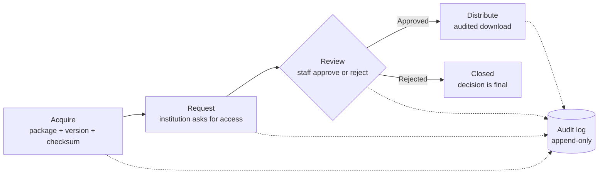

# Audited Code Library


**Who received which version of which simulation code, and who approved it?**

This app can always answer that question.

Audited Code Library is a demo of a secure, accountable workflow for the acquisition, review, and distribution of scientific software. Researchers request access to a code for their institution. Staff review each request. Every step goes into an append-only audit log that cannot be edited or deleted through the app.

## Why this exists

International scientific data centres share specialised software, such as simulation codes and benchmark data, with universities, research labs, and industry across many countries. Some codes carry licence terms or export controls. These centres need a clear record of every request, every decision, and every distribution, and they need to trust that record for years.

This project shows how I would build the core of that system: Python, Django, PostgreSQL, a REST API, containers, and CI.

## The workflow



Every arrow to the audit log happens in the same database transaction as the action itself. If the log entry cannot be written, the action does not happen.

## Features

- [x] **Acquire:** catalogue of code packages and versions, each with a SHA-256 checksum
- [x] **Request:** institutions request a specific version, with a stated purpose
- [x] **Review:** staff approve or reject in the admin, and each decision is final
- [x] **Distribute:** approved users download through the API, and each download is logged
- [x] **Audit:** append-only log of every action, protected in the app and the admin
- [x] REST API for packages and requests (Django REST Framework)
- [x] 15 automated tests, run against PostgreSQL in CI
- [x] Docker setup with PostgreSQL
- [x] CI pipeline with GitHub Actions

## Tech stack

| Area      | Tools                                       |
| --------- | ------------------------------------------- |
| Language  | Python 3.12                                 |
| Framework | Django 5.2 LTS, Django REST Framework       |
| Database  | PostgreSQL 17 (SQLite for quick local work) |
| Platform  | Linux containers (Docker, Docker Compose)   |
| Quality   | Ruff, Django test framework                 |
| CI        | GitHub Actions                              |

## Quick start with Docker

You only need [Docker Desktop](https://www.docker.com/products/docker-desktop/).

**1. Clone the repo**

```bash
git clone git@github.com:cecrandell/audited-code-library.git
cd audited-code-library
```

**2. Create your `.env` file**

```bash
cp .env.example .env
```

Make a secret key and paste it into `.env` as `SECRET_KEY`:

```bash
python3 -c "import secrets; print(secrets.token_urlsafe(50))"
```

Choose any value for `POSTGRES_PASSWORD`. It only lives on your computer.

**3. Start the app**

```bash
docker compose up --build
```

**4. Create an admin user** (in a second terminal)

```bash
docker compose exec web python manage.py createsuperuser
```

**5. Open it**

- Admin: http://localhost:8000/admin
- API: http://localhost:8000/api

Tip: the terminal shows `http://0.0.0.0:8000`. That is where the server listens, so your browser cannot open it. Use `localhost`.

## A five-minute tour

1. **Acquire.** In the admin, add an institution (for example, "Université Paris-Saclay", country `FR`). Then add a code package with one version. For a real checksum, run `shasum -a 256 README.md`.
2. **Request.** Log in at http://localhost:8000/api-auth/login/, open `/api/requests/`, and create a request.
3. **Review.** In the admin, tick the request and choose **Approve selected pending requests**.
4. **Distribute.** In the API, open your request, go to `download/`, and click **POST**.
5. **Audit.** Open **Audit logs** in the admin and read the full history of that code, step by step.

Now try to edit or delete an audit entry. You can't. That is the point. 🔒

## Run without Docker

```bash
python3.12 -m venv .venv
source .venv/bin/activate
pip install -r requirements.txt
cp .env.example .env        # then add your SECRET_KEY
python manage.py migrate
python manage.py createsuperuser
python manage.py runserver
```

<details>
<summary><strong>New to GitHub? Set up an SSH key first</strong></summary>

An SSH key lets your computer talk to GitHub securely. You only do this once per computer.

Use the email on your GitHub account, or your private address from **Settings > Emails** (it ends in `@users.noreply.github.com`):

```bash
ssh-keygen -t ed25519 -C "you@example.com"
eval "$(ssh-agent -s)"
ssh-add --apple-use-keychain ~/.ssh/id_ed25519
pbcopy < ~/.ssh/id_ed25519.pub
```

On GitHub, go to **Settings > SSH and GPG keys > New SSH key**, paste, and save. Then test it:

```bash
ssh -T git@github.com
```

If GitHub greets you by name, you are in. Never share the private key (the file without `.pub`).

</details>

## Data model

| Model            | What it stores                                                |
| ---------------- | ------------------------------------------------------------- |
| `Institution`    | The organisation that requests a code, with its country       |
| `CodePackage`    | A simulation code or tool. Restricted codes need extra review |
| `PackageVersion` | One release of a code, with its SHA-256 checksum              |
| `AccessRequest`  | One user asks for one version, with a stated purpose          |
| `AuditLog`       | A permanent, append-only record of every action               |

**About checksums:** SHA-256 turns any file into a 64-character fingerprint. Change one byte, and the fingerprint changes completely. A matching checksum proves that a code arrived exactly as it was released.

## Design decisions

**Accountability lives in the database.** A check constraint refuses any reviewed request without a reviewer and a review time. A unique constraint stops duplicate version numbers. These rules hold even if application code has a bug. During development, a manual status change in the admin skipped the app's checks, and the database blocked it. The safety net worked.

**History cannot disappear.** Foreign keys use `PROTECT`, so you cannot delete a user, code, or request that has history.

**The audit log is append-only.** The app blocks edits and deletes, and the admin hides those options for everyone. One honest limit: Django bulk queries can skip model methods. In production, database permissions should also remove UPDATE and DELETE rights on the audit table.

**Each decision and its record are one unit.** Approve and Reject run inside `transaction.atomic()`, so the status change and the audit entry save together or not at all. `select_for_update()` locks the rows, so two staff members cannot review the same request at once.

**The API is secure by default.** Every endpoint needs a login. Users see only their own requests, and requests from other users return 404, so the API does not reveal which records exist. Download is a POST, because it writes to the audit log.

**Queries stay efficient.** `select_related` and `prefetch_related` keep each API page to a few queries, however many codes the catalogue holds.

## Continuous integration

GitHub Actions runs on every push and pull request:

1. Lints the code with Ruff.
2. Runs Django's system check.
3. Fails if a model change has no migration.
4. Runs the test suite against PostgreSQL 17.
5. Builds the Docker image.

## Next steps

This demo covers the core workflow. In production, I would add:

- **Distribution reports** by code, country, and month.
- **Real file storage**, with checksums verified on upload.
- **Parity tests before any legacy migration**, so business logic stays the same.

## REST API

All endpoints need a login.

| Method | Endpoint                       | Description                           |
| ------ | ------------------------------ | ------------------------------------- |
| GET    | `/api/packages/`               | List packages and versions            |
| GET    | `/api/requests/`               | List your own access requests         |
| POST   | `/api/requests/`               | Create an access request              |
| GET    | `/api/requests/<id>/`          | View one of your requests             |
| POST   | `/api/requests/<id>/download/` | Download an approved package (logged) |

For now, download returns the code details and checksum.

## Tests

```bash
docker compose exec web python manage.py test    # PostgreSQL
python manage.py test                            # SQLite
```

The 15 tests check that:

- A code cannot have two versions with the same number.
- The database blocks a reviewed request with no reviewer.
- Audit entries cannot be changed or deleted.
- Adding a code or version in the admin writes audit entries.
- Approve and Reject set the reviewer and write exactly one audit entry.
- A request cannot be reviewed twice.
- The API requires a login, and users see only their own requests.
- Pending requests cannot be downloaded, and approved downloads are logged.

## Developer

Built by Caroline Crandell ([@cecrandell](https://github.com/cecrandell)).
