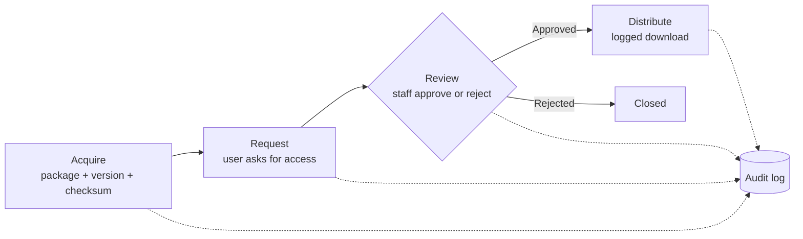

# Audited Code Library


A small Django app for distributing scientific software with a full audit trail. Staff add codes and versions, researchers request access, staff approve or reject, and approved users download. Every one of those steps is recorded in a log that can't be edited or deleted from the app.

The idea came from thinking about research groups that share simulation codes with other institutions. They need to know who has which version and who signed off on it, sometimes years later. This project is my attempt at a small version of that.



**Stack:** Python 3.12, Django 5.2 LTS, Django REST Framework, PostgreSQL 17, Docker, Ruff, GitHub Actions.

## Getting Started

The easiest way to run it is with [Docker Desktop](https://www.docker.com/products/docker-desktop/).

```bash
git clone https://github.com/cecrandell/audited-code-library.git
cd audited-code-library
cp .env.example .env
```

Open `.env` and set `SECRET_KEY`. You can generate one with:

```bash
python3 -c "import secrets; print(secrets.token_urlsafe(50))"
```

Set `POSTGRES_PASSWORD` to anything you like. It's only used by the local database container.

Then start everything:

```bash
docker compose up --build
```

In a second terminal, create an admin account:

```bash
docker compose exec web python manage.py createsuperuser
```

The admin is at http://localhost:8000/admin and the API is at http://localhost:8000/api. The terminal will say the server is running on `0.0.0.0:8000`, but use `localhost` in your browser.

### Without Docker

This uses SQLite instead of PostgreSQL, which is fine for trying things out:

```bash
python3.12 -m venv .venv
source .venv/bin/activate
pip install -r requirements.txt
cp .env.example .env    # add your SECRET_KEY
python manage.py migrate
python manage.py createsuperuser
python manage.py runserver
```

## Trying It Out

Here's a quick walk through the whole workflow:

1. In the admin, add an institution (any name, with a two-letter country code such as `FR` or `GB`). Then add a code package with one version. If you want a real checksum, `shasum -a 256 README.md` gives you one.
2. Log in to the API at http://localhost:8000/api-auth/login/, go to `/api/requests/`, and create a request for that version.
3. Back in the admin, open Access requests, tick your request, and choose "Approve selected pending requests" from the actions menu.
4. In the API, go to `/api/requests/<id>/download/` and click POST. You'll get the package name, version, and checksum back.
5. Open Audit logs in the admin. Every step you just took is there.

If you try to edit or delete one of those log entries, you'll find you can't.

## Project Layout

```
catalogue/
    models.py         # institutions, packages, versions, requests, audit log
    admin.py          # staff interface and the approve/reject actions
    serializers.py    # what the API shows and accepts
    views.py          # API endpoints, including download
    urls.py           # API routes
    tests.py
config/
    settings.py       # all secrets and environment settings come from env vars
    urls.py           # top-level routes: /admin, /api, /api-auth
Dockerfile
compose.yaml          # app + PostgreSQL for local development
.github/workflows/ci.yml
```

## API

Every endpoint needs you to be logged in. Lists are paginated, 50 items per page.

| Method | Endpoint                       | What it does                                                        |
| ------ | ------------------------------ | ------------------------------------------------------------------- |
| GET    | `/api/packages/`               | List packages with their versions and checksums                     |
| GET    | `/api/requests/`               | List your own requests                                              |
| POST   | `/api/requests/`               | Create a request (send `institution`, `package_version`, `purpose`) |
| GET    | `/api/requests/<id>/`          | View one of your requests                                           |
| POST   | `/api/requests/<id>/download/` | Download an approved package (logged)                               |

Download currently returns the package details and checksum rather than a file. See the known issues below.

## How It Works

Most of the work in this project went into making the history trustworthy.

### Database Rules

- A request can't be marked approved or rejected unless it also records who reviewed it and when. This is a check constraint in PostgreSQL, so it holds even if the Python code has a bug.
- While testing, before the status field was read-only, I set a request to approved directly in the admin. PostgreSQL rejected the save because no reviewer was recorded.
- A package can't have two versions with the same number.
- All foreign keys use `PROTECT`, so nothing with history can be deleted. Staff who leave are deactivated instead, and their name stays on everything they did.

### Audit Log

- Every action and its audit entry are saved in the same transaction. If the log entry fails, the action is rolled back.
- The audit log model refuses edits and deletes.
- The admin page for the audit log is read-only, even for superusers.

### Reviews

- A request's status only changes through the approve and reject actions. It's read-only on the edit page.
- Those actions lock the selected rows with `select_for_update()`. If two reviewers click at the same moment, the second one finds the request is no longer pending and skips it.

### API Access

- Users only see their own requests. Asking for someone else's returns 404, not 403, so you can't use the API to discover which requests exist.
- The server sets the requester from whoever is logged in, so you can't make a request on someone else's behalf.
- Requests can't be edited or deleted through the API.
- Download uses POST, so only a deliberate action can create a download record in the audit log.

### Settings

- The app won't start without a `SECRET_KEY`.
- Debug mode is off unless you explicitly turn it on.
- The Docker container runs as a non-root user.

## Running the Tests

```bash
docker compose exec web python manage.py test    # against PostgreSQL
python manage.py test                            # against SQLite
```

There are 15 tests, plus 2 skipped tests I've written ahead of a feature that isn't built yet (see below). Most of them go through the real admin pages and API rather than calling model methods directly, and a lot of them check that something is refused: duplicate versions, approvals without a reviewer, editing the audit log, reviewing the same request twice, seeing another user's request, and downloading before approval.

GitHub Actions runs on every push to `main` and every pull request. It runs Ruff, Django's system check, a check for missing migrations, and the full test suite against a real PostgreSQL 17 database, and it builds the Docker image in a separate job.

## Known Issues

This is a demonstration, so there are gaps. These are the ones I know about and what I'd do next:

- The audit log is protected at the application level, but Django's bulk operations (`.update()` and `.delete()` on a queryset) and raw SQL can still get round it. In production, I'd give the app a database role that can only insert into the audit table.
- Editing a package or version in the admin isn't logged, only creating one is. Request details can also still be edited after a decision. Both should be fixed: log the changes, and make decided requests fully read-only.
- Packages have an `is_restricted` flag, but nothing enforces it yet. The plan is a separate permission for reviewers who can approve restricted codes. The tests for this are already in `tests.py`, marked as skipped.
- Users pick their own institution when they make a request, and nothing checks they belong to it. Users should be linked to an institution, and the server should set it.
- Every logged-in user can see every package, including restricted ones. Whether that's acceptable depends on the policy for those codes.
- Download returns metadata, not a file, and approvals never expire. Real file storage, with checksums calculated on upload, and an expiry date would be next.
- The row locking during reviews isn't covered by a test. Testing it properly needs two database connections running at once against PostgreSQL, which I haven't set up yet.
- The API isn't versioned. I'd move it to `/api/v1/` before any outside client relied on it. The tests use route names, so they wouldn't need to change.
- The Docker setup is for development. It uses Django's built-in server and mounts the project folder. For production, I'd use gunicorn behind a reverse proxy, configure HTTPS and static files, and run migrations as a separate release step.

## Ideas for Later

Things that are out of scope for now but would make this closer to a real service:

- A FastAPI service alongside Django, reading the same PostgreSQL database, with automatic API documentation.
- Monthly distribution reports by package and country.
- Distributing benchmark data sets as well as codes.
- Automatically testing submitted codes in isolated containers, with the results recorded in the audit log.
- Parity tests for migrating legacy code to a new language, to show the business logic hasn't changed.
- Running the app on Kubernetes.
- A full deployment pipeline: tests and a container build on every pull request, then a staging environment, then production with a quick way to roll back.
- Scheduled database backups with a tested restore, plus monitoring and alerts.
- Single sign-on.
- A search assistant for public code documentation, using retrieval-augmented generation. Restricted material would never be sent to an external AI service.

## Developer

Caroline Crandell ([@cecrandell](https://github.com/cecrandell))
